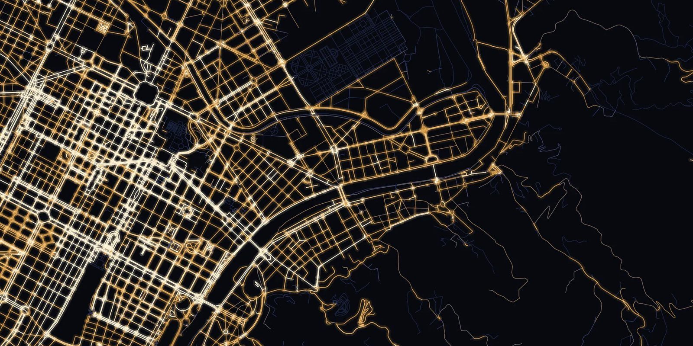

# PedSimCity

**An agent-based model of how people walk through cities: where they go, which streets they take,
and what they know of the city they are walking in.**

[](https://github.com/g-filomena/PedSimCity/actions/workflows/test.yml)
[](https://www.gnu.org/licenses/gpl-3.0.en.html)



*Turin's streets coloured by measured illuminance, from the city's lamp inventory: what a
pedestrian in the night module plans with after dark.*

PedSimCity simulates pedestrians across the full street network of a city, from a few hundred
agents to tens of thousands. Its agents do not follow the shortest path by default. Each one
carries a **cognitive map** - the streets, landmarks, districts and barriers it knows, after Kevin
Lynch's *The Image of the City* - and chooses routes the way people have been observed to: by
distance, by fewest turns, towards landmarks, through districts, along or away from barriers.

On top of that route-choice core, the model can reproduce a whole day of a city:

- **A census population.** Agents are drawn per census section, with age group, occupation and
  sex; residents are joined by inbound commuters and overnight tourists.
- **A day of activities.** Work, study, lunch, shopping and leisure, with destinations chosen by
  attraction against distance and habit, and departures following each persona's day.
- **Walking as part of every mode.** A trip that is not walked can still put someone on the street,
  between home and a transit stop or between a car park and the destination.
- **The city after dark.** Sunrise and sunset for the date and the city's position. Streets cost
  more the darker they are, parks and water cost more at night, and agents re-plan when a street
  is darker than they expected. Women and men can be simulated as paired twins that differ only in
  that respect.
- **Learning a city.** Agents remember the streets they walk, forget them over weeks, and plan
  with what they know.

Every run is reproducible: the same seed gives the same run, trip for trip, on any machine.

## Quick start

You need **JDK 21**, **Maven 3.9+** and **[Git LFS](https://git-lfs.com)** (the city data is
stored there).

```bash
git clone https://github.com/g-filomena/PedSimCity.git
cd PedSimCity
git lfs pull

# one day of Turin, night module, 0.1% of residents (~850 agents)
mvn compile exec:java@night -Dexec.args="--cityName=Torino --days=1 --percentage=0.001"
```

The run logs to the terminal and writes its results to `outputs/`. For a live view in the browser,
use `mvn compile exec:java@night-website` instead.

Every parameter of every module can be set as `--name=value`. A city can also carry its own
defaults in `src/main/resources/<City>/<City>.properties`, which the command line overrides.

## Modules

`core` holds the engine, routing, cognitive maps and movement, and every module extends it. Each
module has its own README.

| Module | What it models |
|---|---|
| [`core`](src/main/java/pedsim/core/README.md) | engine, route choice, cognitive maps, the REST API and dashboard |
| [`activity`](src/main/java/pedsim/activity/README.md) | a 24-hour city: census population, daily programmes, destination and mode choice, commuters and tourists, day and night |
| [`night`](src/main/java/pedsim/night/README.md) | extends `activity`: lighting-aware routing, vulnerability, paired A/B twins |
| [`learning`](src/main/java/pedsim/learning/README.md) | extends `activity`: a cognitive map that grows with walking and fades with time |
| [`cityImage`](src/main/java/pedsim/cityimage/README.md) | extends `core`: route-choice experiments with landmarks, regions and barriers |
| [`empirical`](src/main/java/pedsim/empirical/README.md) | extends `core`: agents calibrated on a route-choice survey (Münster) |

| Module | headless | browser dashboard |
|---|---|---|
| night | `mvn compile exec:java@night` | `mvn compile exec:java@night-website` |
| activity | `mvn compile exec:java@activity` | `mvn compile exec:java@activity-website` |
| learning | `mvn -Plearning compile exec:java@learning` | `mvn -Plearning compile exec:java@learning-website` |
| cityImage, empirical | `mvn -Pcityimage-empirical compile exec:java -Dexec.mainClass=...` | - |

The default Maven profile builds `core`, `activity` and `night`. `mvn -Pall-modules compile` builds
everything.

### Route-choice experiments (cityImage)

The cityImage module reruns the experiments of the papers below. `--stringMode` selects the design:

```bash
mvn -Pcityimage-empirical compile exec:java \
  -Dexec.mainClass=pedsim.cityimage.launcher.CityImageLauncher \
  -Dexec.args="--cityName=Muenster --stringMode='Testing Urban Subdivisions'"
```

The designs are *Testing Landmarks*, *Testing Urban Subdivisions*, *Testing Specific Route Choice
Models* and *Empirical ABM*. `--numberTripsPerAgent` and `--jobs` override a design's own settings;
`--testingSpecificOD=true` with `--originsTmp` and `--destinationsTmp` (comma-separated node IDs)
routes chosen origin-destination pairs.

## Cities

| City | Ships with | Typical use |
|---|---|---|
| Torino | census, employment, POIs, street lighting, transit stops, car parks, tourist accommodation | activity, night, learning |
| London | buildings with heights, landmarks, sight lines, districts, barriers, GPS tracks | route choice |
| Melbourne | official building footprints, landmarks, sight lines, barriers | route choice, validation against pedestrian counters |
| Barcelona | buildings, POIs, sight lines, barriers | learning, route choice |
| Münster | landmarks, barriers, route-choice survey | empirical, route choice |
| Paris | network, districts, barriers | urban subdivisions |

### Your own city

The layers are built from OpenStreetMap (and from official data where you have it) by a Python
pipeline on [cityImage](https://github.com/g-filomena/cityImage):

```bash
conda env create -f environment-prep.yml
conda activate pedsimcity-prep
pip install -U cityImage
python pipeline/00_city_preparation.py --city Bologna --place "Bologna, Italy"
```

Raw inputs go in `inputData/<City>/`; what the simulation reads is written to
`src/main/resources/<City>/`, and `--cityName=<City>` runs it. Census, lighting and transit layers
have their own steps. See [`pipeline/README.md`](pipeline/README.md).

## Outputs

Every run writes under `outputs/`: pedestrian volumes per street and hour, trips and their routes,
cognitive maps, and a per-trip diagnostic file. Volumes and routes are GeoPackages and CSVs keyed on
the network's `edgeID`, so they join straight back onto the street layer.

Large runs should pass `--exportHtmlDashboard=false`, since the HTML dashboard embeds every trip, and
`--exportRoutes=false` when the trips' route geometries are not needed.

### REST API

The `-website` launchers start a REST server on `http://localhost:8081` and open `dashboard.html`.

| Endpoint | Description |
|---|---|
| `GET /api/state` | live simulation state: agents, statistics, module |
| `GET /api/roads` | the street network as GeoJSON |
| `GET /api/modules` | runnable modules and their parameters |
| `POST /api/start` | start a run, e.g. `{"module":"night","cityName":"Torino","days":1}` |

## Studies built with PedSimCity

- **Landmarks** (London): *Modelling the effect of landmarks on pedestrian dynamics in urban
  environments*, [Computers, Environment and Urban Systems](https://doi.org/10.1016/j.compenvurbsys.2020.101573) (2021).
- **Regions and barriers** (London, Paris): *Perception of urban subdivisions in pedestrian
  movement simulation*, [PLOS ONE](https://doi.org/10.1371/journal.pone.0244099) (2020).
- **Empirical ABM** (Münster): *Empirical characterisation of agents' spatial behaviour in
  pedestrian movement simulation*, [Journal of Environmental Psychology](https://doi.org/10.1016/j.jenvp.2022.101807) (2022).
- **Turin after dark**: walking at night, street lighting and the gap between women and men -
  [pedsimcity.inclusivestreets.org](https://pedsimcity.inclusivestreets.org).

The computational approach to *The Image of the City* behind the cognitive maps is in
[Cities](https://doi.org/10.1016/j.cities.2019.01.006) (2019). The model is described following the
ODD protocol in [`PedSimCity_ODD.pdf`](PedSimCity_ODD.pdf).

## Citing

If you use PedSimCity, please cite the software (GitHub's *Cite this repository* button reads
[`CITATION.cff`](CITATION.cff)) and the paper for the part of the model you used.

## Development

| Path | Contents |
|---|---|
| `src/main/java/pedsim/<module>/` | Java source, one folder per module |
| `src/test/java/` | JUnit 5 tests |
| `src/main/resources/<City>/` | the layers the simulation reads, `<City>_<layer>.gpkg` |
| `inputData/<City>/` | raw material for the pipeline |
| `pipeline/` | the Python data pipeline |
| `analysis/` | notebooks and scripts for analysing runs |
| `scripts/` | launchers for the pipeline and the dashboard |

`mvn test` runs the unit tests in about a second. Tests that need a city are tagged `slow`:
`mvn test -Pslow-tests -Pall-modules` runs them (about a minute).

Java is formatted with [Spotless](https://github.com/diffplug/spotless) and google-java-format.
The git hooks in `.githooks/` apply it on commit and check it on push; install them once per clone
(see [`.githooks/README.md`](.githooks/README.md)), or run `mvn spotless:apply` by hand.

PedSimCity is built on [MASON](https://cs.gmu.edu/~eclab/projects/mason/),
[GeoMason-light](https://github.com/g-filomena/GeoMason-light) and
[JTS](https://github.com/locationtech/jts).

## License

[GPL-3.0](LICENSE). Developed by Gabriele Filomena and colleagues, Department of Geography and
Planning, University of Liverpool.
